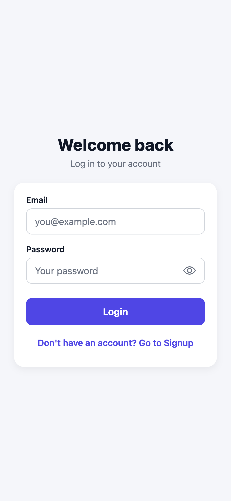
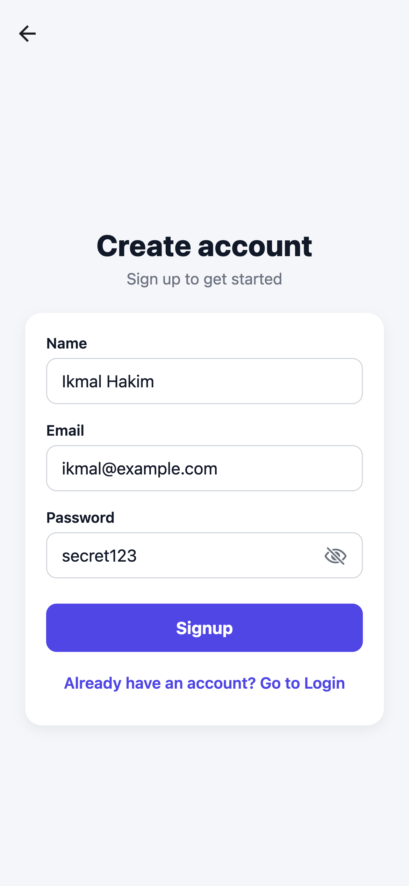
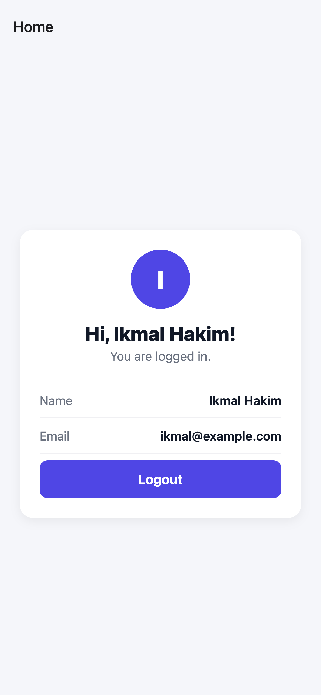
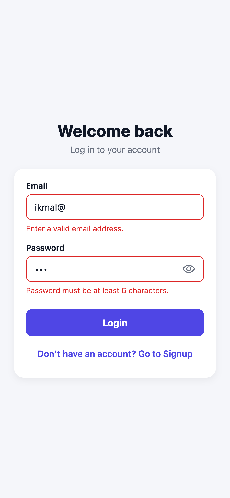
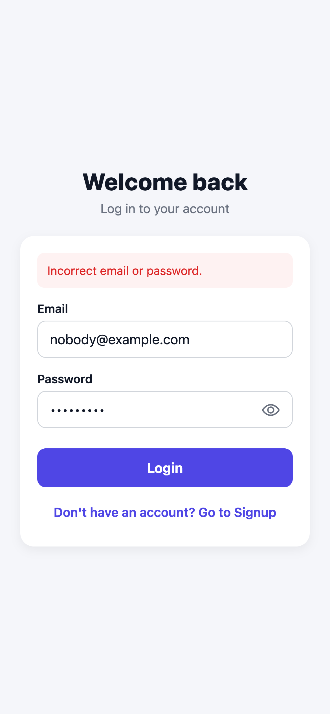
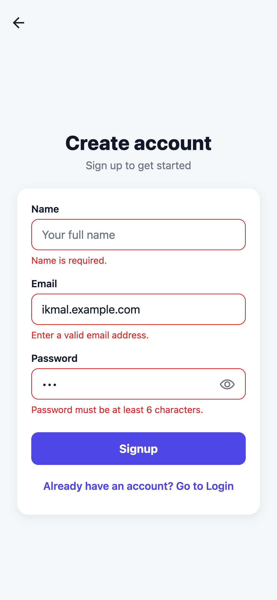
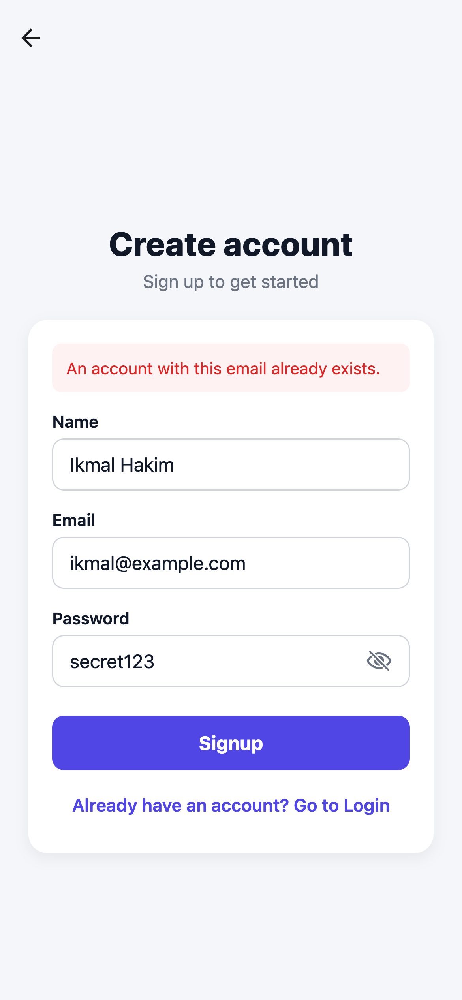

# User Authentication App

A React Native (Expo) app with Login, Signup and Home screens. Authentication state is managed with the React Context API and saved with AsyncStorage, so you stay logged in after closing the app.

## Demo video

[Watch the demo (4.5 min)](demo/demo.mp4): validation errors, password toggle, signup, persistent login, logout, wrong credentials, duplicate email and a short code tour. Recorded on a phone with Expo Go.

## Screenshots

| Login | Signup (password shown) | Home |
|---|---|---|
|  |  |  |

| Login: invalid format | Login: incorrect credentials | Signup: missing / invalid fields | Signup: duplicate email |
|---|---|---|---|
|  |  |  |  |

_Screenshots were taken from the web build (`npm run web`) at iPhone screen size._

## Setup

Requirements: [Node.js](https://nodejs.org) 18 or newer, and the **Expo Go** app on your phone (or an iOS Simulator / Android Emulator).

```bash
git clone <your-repo-url>
cd user-auth-app
npm install
npx expo start
```

Then scan the QR code with Expo Go (Android) or the Camera app (iOS), or press `i` for the iOS Simulator or `a` for the Android Emulator.

## Features

### 1. AuthContext (`context/AuthContext.js`)
A single `AuthProvider` wraps the app and exposes, through the `useAuth()` hook:

| Value | What it does |
|---|---|
| `user` | The logged-in user's `{ name, email }`, or `null` when logged out |
| `signup(name, email, password)` | Creates an account (rejects duplicate emails) and logs the user in |
| `login(email, password)` | Checks the credentials against saved accounts and sets `user` |
| `logout()` | Clears the session and sets `user` to `null` |
| `isLoading` | `true` while the saved session is being restored on startup |

`login` and `signup` return `{ ok: true }` or `{ ok: false, error }`, so screens can show the message directly.

### 2. Screens
- **Login:** email and password fields. Shows errors for an invalid email format, a password that is too short, and incorrect credentials. Has a "Go to Signup" button.
- **Signup:** name, email and password fields. Shows errors for missing fields, an invalid email format, a password under 6 characters, and an email that is already registered. Has a "Go to Login" button.
- **Home:** shows the logged-in user's name and email, with a Logout button.

### 3. Persistent login (AsyncStorage)
Registered accounts and the current session are stored in AsyncStorage. On startup the app restores the saved session, so a logged-in user goes straight to Home.

### 4. Navigation (React Navigation)
`App.js` uses a native stack navigator that renders **either** the Login/Signup screens **or** the Home screen, depending on whether `user` is set. Logging in or out updates `user`, and the navigator switches screens on its own with no manual `navigate('Home')` calls. This also means the back button can't return to Login after logging in.

### 5. UI
Card-based layout, labelled inputs, red borders and messages for errors, a loading spinner on buttons and keyboard-aware scrolling.

### Bonus: password visibility toggle
Password fields have an eye icon that shows or hides the password (`components/FormInput.js`).

## Project structure

```
App.js                     Navigation + AuthProvider
context/AuthContext.js     Global auth state (user, login, signup, logout)
screens/LoginScreen.js
screens/SignupScreen.js
screens/HomeScreen.js
components/FormInput.js    Input with label, error text and eye toggle
components/PrimaryButton.js
utils/validation.js        Email / password / required-field checks
theme.js                   Shared colors
```
